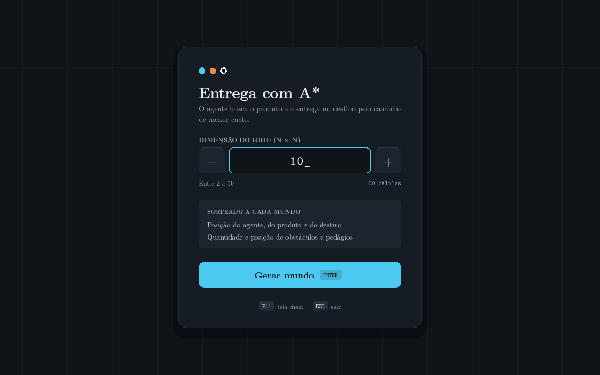
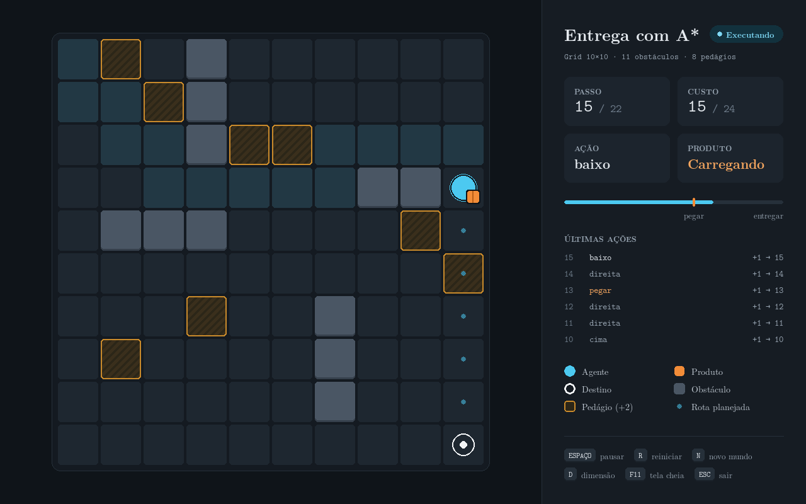
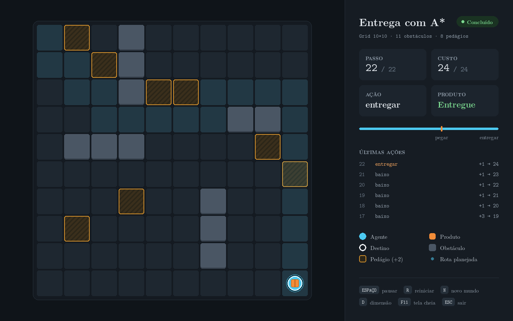
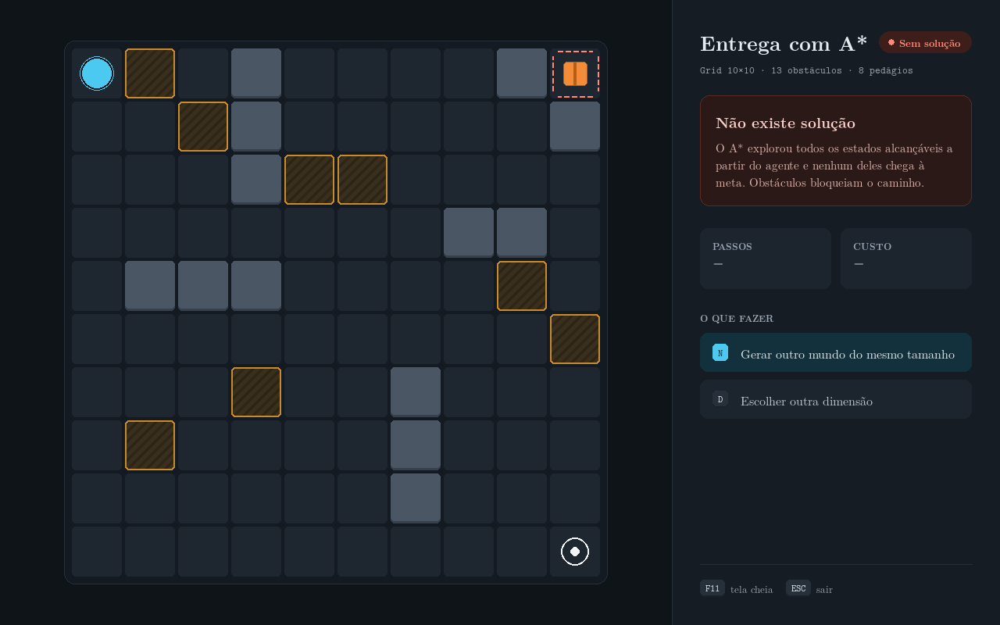

# Entrega com A* em um mundo grid

Implementação da APS baseada na questão da avaliação intermediária: um agente precisa **pegar um produto e entregá-lo no destino** pelo caminho de menor custo, em um mundo do tipo grid com obstáculos e regiões com pedágio.

A busca usa o algoritmo **A\*** da biblioteca [`aigyminsper`](https://pypi.org/project/aigyminsper/), e uma interface gráfica em `pygame` permite escolher a dimensão do grid, gera o mundo aleatoriamente e anima o caminho encontrado.


*Mundo de exemplo da questão da prova (10×10).*

## Como executar

Testado com Python 3.13.

```bash
python -m venv .venv
.venv\Scripts\activate          # Windows
# source .venv/bin/activate     # Linux / macOS
pip install -r requirements.txt
python src/main.py
```

O programa abre em tela cheia, pede a dimensão N do grid (de 2 a 50), gera um mundo N×N aleatório, executa a busca e anima o agente. O resultado da busca também é impresso no terminal.

### Controles

| Tela | Tecla / ação | Função |
|---|---|---|
| Dimensão | dígitos, `↑` `↓` ou botões `−` `+` | escolher N |
| Dimensão | `ENTER` ou botão *Gerar mundo* | gerar o mundo e buscar |
| Grid | `ESPAÇO` | pausar / continuar a animação |
| Grid | `R` | reiniciar a animação |
| Grid | `N` | gerar outro mundo do mesmo tamanho |
| Grid | `D` | voltar e escolher outra dimensão |
| Todas | `F11` | alternar entre tela cheia e janela |
| Todas | `ESC` | sair |

## Estrutura do repositório

```
├── src/
│   ├── AgentSpecification.py   # especificacao do agente
│   ├── main.py                 # geração do mundo aleatório, busca e saída no terminal
│   ├── visualizacao/           # interface gráfica em pygame
│   │   ├── app.py              # janela, eventos e laço principal da animação
│   │   ├── telas.py            # telas completas: escolha da dimensão e grid com painel
│   │   ├── grid.py             # desenho do grid, agente, produto e destino
│   │   ├── painel.py           # painel lateral com o andamento da busca
│   │   ├── componentes.py      # chips de tecla, rótulos e cartões
│   │   ├── tipografia.py       # carregamento das fontes e funções de texto
│   │   └── cores.py            # paleta de cores
│   └── fontes/                 # fonte Latin Modern e sua licença
├── docs/img/                   # capturas de tela usadas neste README
├── requirements.txt
└── LICENSE
```

## Modelagem do problema

A classe `AgentSpecification` estende `State` da `aigyminsper`.

### O mundo

O mundo é compartilhado por todos os estados e fica em atributos da classe: `LINHAS`, `COLUNAS`, `DESTINO`, `OBSTACULOS` e `PEDAGIOS`. Por padrão eles contêm o mundo 10×10 da prova; o `main.py` os substitui por um mundo aleatório antes de cada busca.

### Estado

| Atributo | Descrição |
|---|---|
| `posicao_agente` | célula `(linha, coluna)` do agente |
| `posicao_produto` | célula do produto; depois de pego, ele acompanha o agente |
| `pegou_produto` | o agente está carregando o produto |
| `entregou_produto` | o produto já foi entregue no destino |
| `custo` | custo da ação que gerou este estado |

### Ações e custos

| Ação | Quando é possível | Efeito | Custo |
|---|---|---|---|
| `cima`, `baixo`, `esquerda`, `direita` | a célula de destino está dentro do grid e não é obstáculo | move o agente (e o produto, se estiver carregando) | 1, ou **3** se a célula for pedágio (1 + 2) |
| `pegar` | o agente está na célula do produto e ainda não o pegou | `pegou_produto = True` | 1 |
| `entregar` | o agente está no destino carregando o produto | `pegou_produto = False`, `entregou_produto = True` | 1 |

### Meta

```python
def is_goal(self):
    return self.entregou_produto or (not self.pegou_produto and self.posicao_produto == DESTINO)
```

A meta é ter entregado o produto. A segunda condição cobre o caso em que o produto já começa no destino: nesse caso o estado inicial já é meta e nenhuma ação é necessária.

### Heurística

```python
def h(self):
    if self.is_goal():
        return 0
    if not self.pegou_produto:
        return manhattan(agente, produto) + manhattan(produto, DESTINO)
    return manhattan(agente, DESTINO)
```

A heurística é a distância de Manhattan do que ainda falta percorrer: até o produto e dele até o destino, ou direto até o destino se o produto já está com o agente. Ela é **admissível**, porque cada movimento custa no mínimo 1, só anda uma célula em uma direção, e obstáculos e pedágios apenas aumentam o custo real. Ela também desconsidera o custo das ações `pegar` e `entregar`. Com uma heurística admissível, o A\* encontra o caminho de menor custo.

### Estados repetidos

A busca roda com `pruning='general'`: a biblioteca descarta todo estado cuja representação `env()` já foi vista. Por isso o `env()` inclui tudo o que diferencia um estado de outro:

```python
def env(self):
    return f"{self.posicao_agente}#{self.posicao_produto}#{self.pegou_produto}#{self.entregou_produto}#{self.custo}"
```

Sem `pegou_produto` e `entregou_produto`, o estado logo após `pegar` ou `entregar` teria a mesma representação do anterior e seria descartado, e a busca não chegaria à meta.

## Geração aleatória do mundo

A cada mundo, `gerar_mundo(n)` em `main.py` sorteia:

- a posição do **agente**, do **produto** e do **destino**, em três células distintas e livres;
- a **quantidade** de obstáculos (de 0 a 30% das células) e suas **posições**;
- a quantidade de pedágios (de 0 a 15% das células) e suas posições.

Nenhum obstáculo ou pedágio é colocado sobre o agente, o produto ou o destino. Os limites ficam nas constantes `PROPORCAO_MAXIMA_OBSTACULOS` e `PROPORCAO_MAXIMA_PEDAGIOS`.

## Mundos sem solução

Como os obstáculos são aleatórios, o produto ou o destino podem ficar isolados. Nesse caso o A\* esgota todos os estados alcançáveis e retorna `None`; o programa informa que **não existe solução**, tanto no terminal quanto na interface, e permite gerar outro mundo com `N`.

## Exemplos de execução

### Escolha da dimensão



### Mundo da prova, durante a animação

O agente já pegou o produto e segue para o destino. As células por onde passou ficam destacadas, e a rota que falta aparece em pontos.



### Mundo da prova, entrega concluída



Saída no terminal:

```
Busca A*
Grid 10x10 | agente (0, 0) | produto (2, 8) | destino (9, 9) | 11 obstaculos | 8 pedagios
Achou!
 ; baixo ; direita ; baixo ; direita ; baixo ; direita ; direita ; direita ; direita ; cima ; direita ; direita ; pegar ; direita ; baixo ; baixo ; baixo ; baixo ; baixo ; baixo ; baixo ; entregar
Custo: 24
```

São 22 ações. O custo é 24 porque o caminho passa por um pedágio, em (5, 9); desviar dele custaria pelo menos o mesmo.

### Mundo sem solução

O mesmo mundo da prova, com o produto em (0, 9) cercado por obstáculos.



```
Busca A*
Grid 10x10 | agente (0, 0) | produto (0, 9) | destino (9, 9) | 13 obstaculos | 8 pedagios
Nao existe solucao para este problema
```

## Créditos

- Busca: biblioteca [`aigyminsper`](https://pypi.org/project/aigyminsper/).
- Fonte: [Latin Modern](https://www.gust.org.pl/projects/e-foundry/latin-modern), distribuída sob a GUST Font License (`src/fontes/GUST-FONT-LICENSE.TXT`).